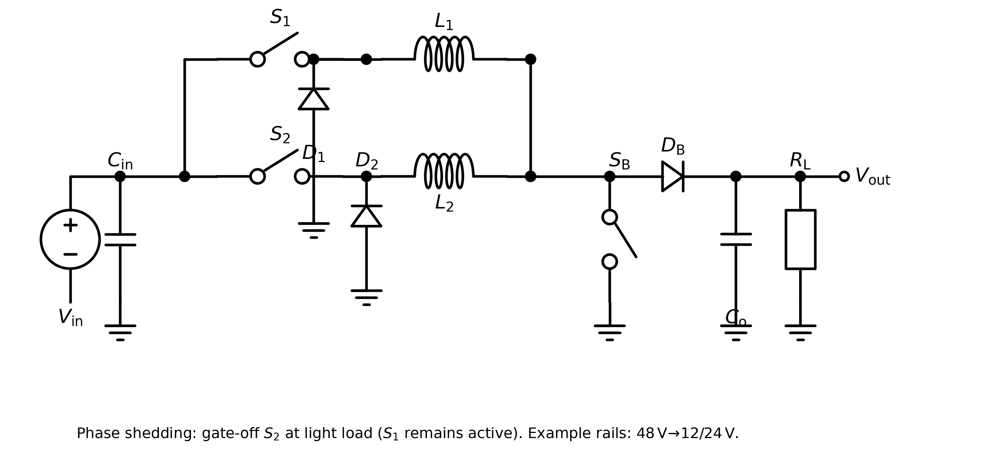
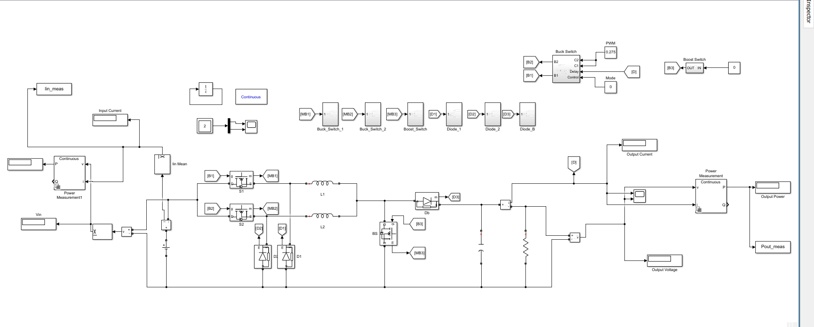
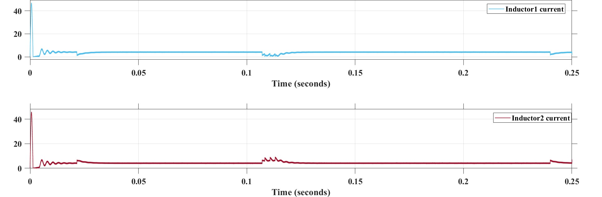
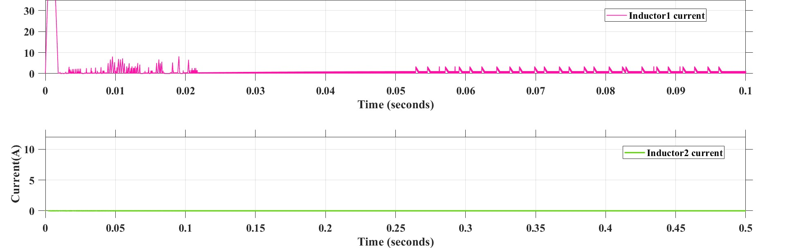
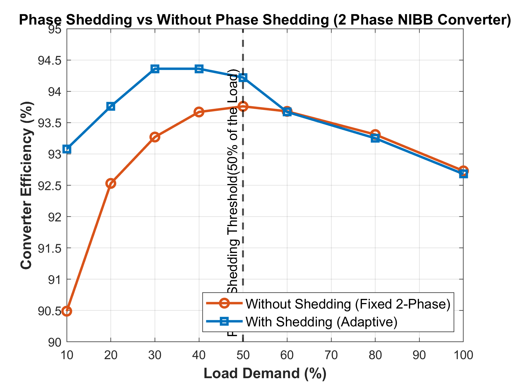

# Two Phase Buck-Boost Converter with Phase Shedding Control

Internship at **Shrimitha Energy Solutions**, 25 May 2026 to 25 June 2026, with **Charumithra**.
College guide: Dr. R. Seyezhai, Department of EEE, SSN College of Engineering.

The power stage is mine. Two interleaved buck phases, then a shared boost leg, so the same converter can step 48 V down to 24 V or 12 V and also step 24 V up to 48 V. About 200–270 W. At light load one buck phase is turned off. Both phases stay on once the load is high. Shedding in this repo is open-loop, from the load percent. No hardware.

Charumithra and I ran the Simulink cases, the loss and efficiency numbers, and the waveforms below. I also built a shared-buck / two-phase-boost arrangement to compare against. That one can shed only on the boost side. The circuit in the title is the one we kept.

`NIBB_TwoPhase_Buck_Closed_Loop.slx` is an early trial on the buck stage alone. It is not closed-loop control of the two-stage converter.

The STIRS 2026 proposal (July) and the slides (August) came after the internship. That proposal is with Deepalakshmi M, same guide.

## Circuit

Two buck phases (S1, L1 and S2, L2), 180° apart, into a shared boost switch SB. Phase shedding is S2 held off at light load. S1 keeps switching.

The Simulink plant this was drawn from:

## Waveforms

Both inductor currents, shedding off. The two phases share the current.

Light load with shedding. Inductor 2 sits at zero. Inductor 1 carries the current.

Output voltage and current for the 48 V to 24 V buck run.

Efficiency against load. Shedding is ahead below the 50% line and the two curves meet once both phases are on.

The rest of the scope shots are in `Inputs/raw/graphs/`. Pin, Pout and efficiency tables are in `Inputs/raw/Final_INTERN.pdf`.

## Runs

| Mode | Conversion | Where shedding acts |
|------|------------|---------------------|
| Buck | 48 V → 24 V | Buck phases |
| Buck | 48 V → 12 V | Buck phases |
| Boost | 24 V → 48 V | Only on the other arrangement (two-phase boost) |

## What is where

- `Outputs/deliverables/sims/learning/` — first buck, boost and interleaving models
- `Outputs/deliverables/sims/nibb-development/` — model ladder up to the two-stage plant
- `Outputs/deliverables/sims/final-circuits/` — final plants, with and without shedding
- `Outputs/process/efficiency/` — `Data.m` compares the two arrangements, `Final_efficiency.m` is shedding vs no shedding
- `Outputs/process/losses/` — loss scripts
- `Outputs/process/figures/` — June plots and the schematic
- `Inputs/raw/lit-review/` — notes on the papers. The PDFs are not in this repo.
- `Inputs/raw/Proposal.pdf` and `Outputs/deliverables/STIRS-2026_Proposal_Phase_Shedding_Converter_DRAFT.docx` — STIRS proposal
- `Outputs/deliverables/ppt/STIRS_2026_PhaseShedding_12.pptx` — slides
- `Wiki/` — decisions, literature list, research gap
- `Inputs/requirements/` — what the internship sim was, and the design target after it

Open the `.slx` files in Simulink. The `.m` files already have the Pin/Pout numbers used for the plots.

Commit dates follow the save times of the files. I was not using git during the internship.
